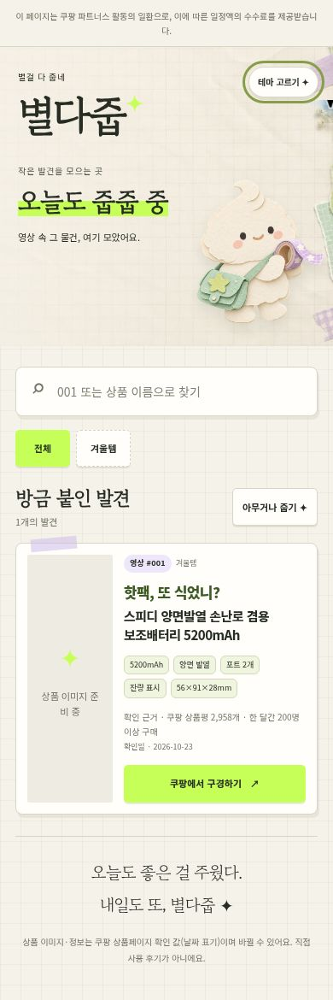
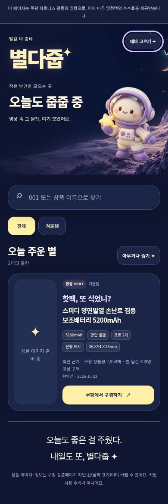

# [GPT] 별다줍 5종 테마와 JSON 기반 상품 페이지

방문자가 영상 번호 또는 상품명으로 쿠팡 상품을 찾고, 다섯 테마를 선택할 수 있는 정적 페이지입니다. 상품은 `data/items.json`에서 읽으며 새 항목과 분류가 코드 수정 없이 나타납니다.

- 기본 A / B 오락실 / C 스크랩북 / D 밤 / E 인벤토리. 배경과 투명 캐릭터를 각각 새로 제작했습니다.
- 번호 검색, 동적 분류, 필터 안 랜덤 선택·강조, `#no001` 이동.
- 테마만 로컬에 기억하고, 저장소 실패 시 오류 표시 없이 A로 엽니다. 찜·링크 보관함은 없습니다.
- 상단 정식 고지와 하단 출처 안내, 고정 상품 CTA, 데이터에 있는 상품 정보만 표시합니다.

검증: 자동 검사 10개 통과. 실제 브라우저에서 fixture 두 번째 상품 자동 반영, 검색·분류·랜덤·해시 이동을 확인했습니다. A~E 전부 360px·430px에서 가로 넘침이 없었습니다. 상세 결과는 `docs/QA.md`에 있습니다.

실제 상품 이미지 `assets/items/001.webp`는 Claude가 추가할 예정이며 현재는 준비 중 표시입니다. 이 PR은 Pages를 활성화하거나 배포하지 않습니다.

| A 동네 줍줍상점 | B 줍줍 오락실 | C 발견 스크랩북 | D 별 주운 밤 | E 인벤토리 |
|---|---|---|---|---|
|  |  |  |  |  |

이 파일은 PR 설명의 작성 원고입니다. 실제 원격 PR 링크와 상태는 인계 기록에서 확인합니다.
